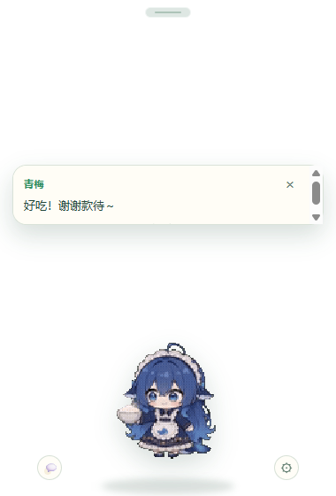

# 青梅桌面宿主（桌宠）



Electron 透明置顶小窗：一只青梅坐在桌面角落，服务器通知变成头顶气泡；点它互动、右键菜单、
聊天输入、拖到哪停哪，透明区域点击穿透。

## 运行

```bash
cd qingmei
pnpm install
pnpm --filter @qingmei/desktop start
```

首次启动会弹设置：

- **服务器地址**：生产用 `https://139.155.78.241:8710`（nginx）；本机服务用 `http://127.0.0.1:7410`
- **访问令牌**：和 Web 面板同一个 `QM_TOKEN`

也可以用环境变量跳过首次输入：

```bash
QM_SERVER_URL=https://139.155.78.241:8710 QM_TOKEN=... pnpm --filter @qingmei/desktop start
```

令牌优先用 Electron `safeStorage`（Windows DPAPI）加密存到用户数据目录；系统不支持时退化为明文，
设置页有说明。

## 设置

右键桌宠 →「设置…」或托盘 →「设置…」：

- 服务器地址 / 访问令牌 / 测试连接
- 形象：青梅 / 小光球
- 桌宠大小 70%–150%
- 文字大小 85%–130%（只缩放气泡/聊天/设置，不动桌宠）
- 互动音效开关
- 开机自启
- 隐藏时系统通知
- 全屏应用时自动隐藏
- 窗口位置会记住，并在显示器变化后回到可见区域

## 交互

| 操作 | 效果 |
| --- | --- |
| 单击桌宠 | 随机播一个点击回应动画，冒一句台词，偶尔掉爱心 |
| 双击桌宠 | 喂饭：吃白饭动画 + 爱心 + 台词 |
| 右键桌宠 | 摸摸头 / 喂饭 / 逗一下 / 选个动作… / 聊聊天 / 设置 / 重新连接 / 躲起来 / 退出 |
| 托盘 | 显示 / 隐藏 / 设置 / 退出 |
| 顶部小横条 | 移动窗口，位置会记住；拖整只也可以 |
| 头顶气泡 | 显示服务器通知；点击气泡打开聊天；× 关闭，+N 表示排队条数 |
| 聊天输入 | 回车发送；回复按 SSE `chunk` 流式显示，最终消息渲染 Markdown；历史图片从 `blocks_json` 回显 |
| 离线 | 发送失败自动排队，联网后自动补发 |
| 闲置 20 秒 | 35% 概率自己找个乐子（照镜子 / 蓝鲸 / 玩水枪），否则继续待机 |
| 闲置 90 秒 | 打盹，动一下或点它醒来 |
| 透明区域 | 点击穿透到桌面；只有桌宠/气泡/聊天/设置区域接收鼠标 |

## 通知来源

订阅 `GET /api/v1/events?token=...`，映射规则在 `renderer/core.mjs`：

- `assistant`：所有回复与主动消息（提醒、督促、复盘、周报等）→ 气泡
- `approval-requested`：审批待确认 → 审批气泡
- `task-finished` 且失败 → 故障气泡
- `chunk`：只进聊天面板流式显示，不弹气泡，避免刷屏

窗口隐藏时，普通通知会走 Windows 系统通知；点击通知恢复桌宠。

## 打包

```bash
pnpm --filter @qingmei/desktop dist        # 免安装 portable exe
pnpm --filter @qingmei/desktop dist:nsis   # NSIS 安装包；当前环境需把 TEMP 指到可写目录
```

产物在 `apps/desktop/dist/`。应用图标在 `apps/desktop/build/icon.ico`（由桌宠预览图生成）。`n`n签名与自动更新的环境变量见 [SIGNING.md](SIGNING.md)。

## 测试

```bash
node --test apps/desktop/test
```

覆盖 SSE 分块解析、事件转气泡、气泡队列过期、地址/令牌编码、历史映射，以及窗口参数、
preload 最小面、界面元素、缩放/自启/全屏检测/通知契约。

## 常见问题

- **启动后没有窗口**：确认不是从设置了 `ELECTRON_RUN_AS_NODE=1` 的终端启动。
- **electron/dist 不存在**：`pnpm install` 跳过了 Electron 下载脚本时，执行
  `node apps/desktop/node_modules/electron/install.js`（国内先设
  `ELECTRON_MIRROR=https://npmmirror.com/mirrors/electron/`）。
- **全屏自动隐藏**：使用 `electron/fullscreen.exe` 检测前台窗口，只在 Windows 生效；
  每 6 秒检测一次。

## 素材与许可

桌宠动画取自 [PC2005-cloud/dsh-pet](https://github.com/PC2005-cloud/dsh-pet)（MIT），经
[shenliuyu18/dafeiyu-pet](https://github.com/shenliuyu18/dafeiyu-pet) 使用；透明 WebM（VP9 alpha，
640×360），固定尺寸播放，不叠加缩放/倾斜动画。许可全文见
`renderer/assets/THIRD-PARTY-dsh-pet-LICENSE.txt`。

## 已知限制

- 没有代码签名，Windows SmartScreen 可能提示未知发布者。
- 系统通知只在窗口隐藏时发送，标题固定为「青梅」。
- 透明窗口在部分远程桌面/无交互会话下可能无法显示。
- 点击穿透依赖 `setIgnoreMouseEvents(..., { forward: true })`，Windows 支持最好。
- 番茄钟/喂饭账本还没做。
- QM_DESKTOP_SCREENSHOT / QM_DESKTOP_ACTION 只在未打包的开发模式生效，打包版已关闭。
